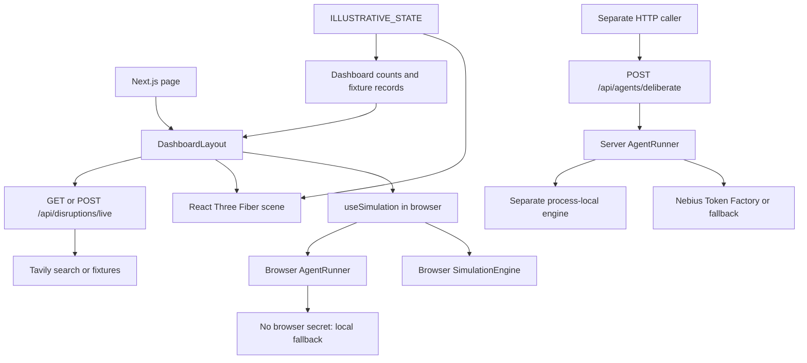

# Architecture and implementation status

Repository assessment: October 26, 2026. This describes code inspected in the working tree, including the in-progress Tavily integration. The [PRD](idea_intro.md) remains the intended product contract.

## Product model

A supervisor rehearses warehouse disruptions. Independent software agents negotiate dock, yard, and cargo decisions. The simulation engine should be the sole authority for physical state and commitments; the model proposes structured actions, and rendering observes accepted results. Facility specifications, unknown operational inputs, synthetic workloads, and hypothetical interventions must remain distinguishable.

The strongest submission story is a closed dock causing a driver, dock lead, and yard controller to negotiate an alternative, with the engine rejecting conflicts and showing the resulting action. This is an engineering target; the complete loop is not yet connected.

## Current runtime boundaries

There is no connection from the dashboard deliberation control to the server deliberation route. There is no engine-state input to `FacilityScene`. These are the two most consequential integration gaps.

## Modules

| Module | Current behavior |
| --- | --- |
| `app/page.tsx`, `components/dashboard/dashboard-layout.tsx` | Page composition, selection, panels, disruption controls and notifications |
| `lib/dashboard/use-simulation.ts` | Creates browser engine and runner; seeds T-2291 at D-108, yard tractor YT-2 and forklift F-07; invokes local deliberation |
| `lib/engine/engine.ts` | Entity maps, queued events, movement/unload actions, disruptions, scoped observations, snapshot/restore |
| `lib/engine/commitments.ts` | Proposal, acceptance, validation, resource acquisition, stale-version rejection, request deduplication, expiry |
| `lib/engine/invariants.ts` | Physical location, resource availability, coupling and cargo checks; existence of a helper does not establish that every mutation invokes it |
| `lib/agents/agent-runner.ts` | Four seeded software agents, scoped prompts, in-memory messages/memory, Zod validation and tool dispatch |
| `lib/agents/nebius-client.ts` | OpenAI-compatible HTTP request to configured Nebius endpoint; deterministic fallback on missing key/error/timeout |
| `app/api/agents/deliberate/route.ts` | Validates agent/directive/disruption request; uses its own module-level engine and runner |
| `lib/external/tavily-client.ts` | Optional search; keyword-based mapping of articles to hypothetical interventions; fixture fallback |
| `components/scene/`, `lib/scene/` | Schematic facility, stable entity IDs, model/primitive modes, selection, context recovery; scene uses illustrative state |
| `lib/dashboard/data.ts` | Evidence records, illustrative timeline, dependencies, summaries and explicit unknown fields |

The default agents are DRV-047 (driver), DOCK-C (dock lead), YARD-1 (yard controller), and SUP-1 (supervisor). These identities describe the demo scenario, not actual DFW staff.

## Contracts and important gaps

1. **Live inference boundary.** Move the authoritative run behind a server API and return versioned state/events to the dashboard. Keep credentials server-side. Do not solve this by exposing an API key to the browser. The current module-level API engine is neither durable nor isolated by user/run.
2. **Proposal mismatch.** The model schema accepts `task`, resources, `expiresAt`, and participants. The engine's `CommitmentProposal` requires `id` and `expiresInSeconds`. The runner casts one to the other without an adapter, permitting an undefined ID and invalid expiry. Add explicit translation with stable identities and tests before demonstrating negotiation.
3. **Permissions and actual effects.** Tool schema validation checks shape, not role authorization. Enforce which agent may accept for a participant or mutate a resource. `cancel` and `escalate` currently return success messages without the corresponding resource-release/message-delivery workflow. `observe` falls through the dispatch default.
4. **Negotiation scheduling.** Sending messages exists, but default inboxes/memories are seeded and reference a sample C-88 offer. The runner does not complete the request → offer → all acceptances → commit → execute cycle automatically. Observe and test each transition with real engine records.
5. **State projection.** Bind scene, counts, inspector, and timeline to the same run/version. Currently counts come from illustrative data, and the initial timeline mixes sample events with new interactions. Model provenance now survives the runner/API result, but the UI still needs to display fallback and model identity accurately.
6. **Clock controls.** `nextStep` appends a future `clock_tick` through `emitEvent`, which does not advance the engine clock. Only `step` consumes the event queue and advances time. Pause and speed currently update React controls without an automatic run loop.
7. **Recovery and comparisons.** Engine snapshots capture entity maps/time/version, but omit queued events, deduplication state, sequence counter, agent memory/messages, workload cursor and full history. UI checkpoint returns a notification without storing the snapshot; branch and compare are notifications. Durable replay, compatible baselines and evidence export remain to build.
8. **External evidence.** Tavily results are search context, not proof that a particular DFW dock failed. The route returns `source: "tavily" | "fixture"`; fixtures are titled `[Synthetic]`, carry no URL, and are tagged `synthetic` in the timeline. Only weather and highway news is mapped (weather → hypothetical D-108 closure, highway → DRV-047 delay); unrelated results are dropped. The mapping is still an application hypothesis, and `external_delay` records an event without changing physical state.
9. **Operational grounding.** Property capacities are documented; real staffing, workloads, service times and operating policies remain unknown. Implement workload import and run-readiness validation before claiming calibrated operating results.

## Next implementation sequence

1. Establish one server-owned run and an API-to-dashboard state projection; show model/fallback provenance.
2. Repair the proposal adapter, role authorization, cancellation and automatic message/acceptance loop. Verify the complete D-108 → D-112 scenario, including contested and rejected allocations.
3. Drive scene and summaries from engine events; fix time stepping; distinguish all illustrative and external sources.
4. Implement complete run snapshots, restore/replay, event export, and a deterministic baseline with matching inputs and horizon.
5. Record real Nebius inference, measure latency and coordination outcomes, and produce the submission artifacts.

Do not substitute animation or a success notification for an engine transition. Ship a small verified scenario before expanding the population or adding more roles.

## Verification and working conventions

`pnpm check` runs Biome, Next.js type generation, TypeScript and Vitest. Tests cover layout capacity/selection, dashboard fixture relationships, engine operations, tool schemas, fallback behavior, and external search fallback. Passing unit tests is not evidence that the integrated demo or all PRD acceptance criteria work.

Assessment validation: all 40 tests, Biome, TypeScript and frozen-lockfile validation passed. Provider tests used mocked HTTP responses; no live inference was verified. `pnpm build` was attempted twice, including a permission retry, but Turbopack's CSS worker could not bind a local port in this execution environment (`Operation not permitted`). Production build and clean-machine/browser validation remain unverified; the CI workflow has been added but has not run on GitHub here.

Read installed Next.js guides under `node_modules/next/dist/docs/` before changing framework code, as required by `AGENTS.md`. Keep the core engine independent of rendering. Preserve original asset licenses. Keep secrets in untracked server environment files. Use the existing package manager and lockfile.
